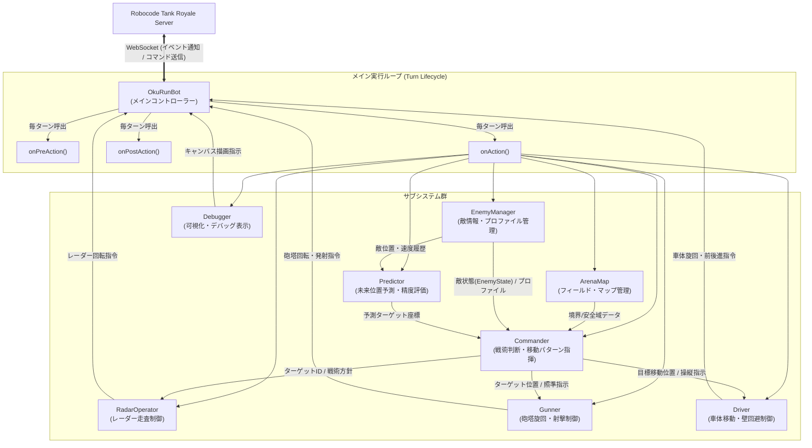

# OkuRunBot v2 システム構成ドキュメント

本ドキュメントでは、Robocode Tank Royale 対応ボット **OkuRunBot v2** の全体システムアーキテクチャ、コンポーネント構成、データフローおよびクラス構造について解説します。

---

## 1. システム概要

`OkuRunBot v2` は、自律型ロボット対戦フレームワーク **Robocode Tank Royale** 上で動作する高機能 AI ボットです。  
コンポーネント指向アーキテクチャを採用し、戦術判断・敵追跡・未来位置予測・移動制御・射撃制御・レーダー走査・デバッグ描画などの役割を個別のサブシステムに分離・モジュール化しています。

---

## 2. 全体システムアーキテクチャ図 (Mermaid)

---

## 3. クラス・コンポーネント詳細図 (Mermaid)

```mermaid
classDiagram
    class OkuRunBot {
        +run()
        +onPreAction()
        +onAction()
        +onPostAction()
        +onScannedBot(ScannedBotEvent)
        +onHitByBullet(HitByBulletEvent)
    }

    class Commander {
        -Map~TacticId, Tactic~ tactics
        -Map~MovePatternId, MovePattern~ movePatterns
        -Tactic currentTactic
        +onAction(OkuRunBot)
        +getTargetEnemyId(OkuRunBot)
        +getTargetMovePosition(OkuRunBot)
    }

    class EnemyManager {
        -Map~Integer, EnemyProfile~ enemyProfiles
        +onScannedBot(ScannedBotEvent)
        +getAliveEnemy(OkuRunBot)
        +detectEnemyBullets()
    }

    class Predictor {
        -Map~PredictModelId, PredictModel~ models
        -ModelAccuracy modelAccuracy
        +predictTargetPosition()
        +updateAccuracy()
    }

    class Driver {
        -DriveAction currentAction
        +onAction(OkuRunBot)
        +setDriveAction(DriveAction)
    }

    class Gunner {
        -GunAction currentAction
        -BulletHistory bulletHistory
        +onAction(OkuRunBot)
        +fireGun()
    }

    class RadarOperator {
        -RadarAction currentAction
        +onAction(OkuRunBot)
    }

    class ArenaMap {
        -double width
        -double height
        +getSafeArea()
        +isNearWall()
    }

    class Debugger {
        +onAction(OkuRunBot)
        +drawDebugGraphics()
    }

    OkuRunBot --> Commander
    OkuRunBot --> EnemyManager
    OkuRunBot --> Predictor
    OkuRunBot --> Driver
    OkuRunBot --> Gunner
    OkuRunBot --> RadarOperator
    OkuRunBot --> ArenaMap
    OkuRunBot --> Debugger

    Commander --> Tactic
    Commander --> MovePattern
    Predictor --> PredictModel
    Driver --> DriveAction
    Gunner --> GunAction
    RadarOperator --> RadarAction

    <<interface>> Tactic
    <<interface>> MovePattern
    <<interface>> PredictModel
    <<interface>> DriveAction
    <<interface>> GunAction
    <<interface>> RadarAction

    Tactic <|.. SurvivalTactic
    Tactic <|.. OneOnOneTactic
    Tactic <|.. AnalysisOneOnOneTactic

    MovePattern <|.. SafeAreaMovePattern
    MovePattern <|.. EnemySideMovePattern
    MovePattern <|.. OppositeSideMovePattern
    MovePattern <|.. RoundAreaMovePattern

    PredictModel <|.. SimplePredictModel
    PredictModel <|.. ZigzagPredictModel
    PredictModel <|.. DynamicPredictModel
    PredictModel <|.. HistoryPredictModel
    PredictModel <|.. NonePredictModel

    DriveAction <|.. AvoidWallDriveAction
    DriveAction <|.. MoveToDriveAction
    DriveAction <|.. MoveToForwardDriveAction

    GunAction <|.. ScanGunAction
    GunAction <|.. TrackingGunAction
    GunAction <|.. MaxPowerGunAction
    GunAction <|.. ExecutionGunAction

    RadarAction <|.. AllScanRadarAction
    RadarAction <|.. TargetScanRadarAction
```

---

## 4. コンポーネント役割定義

| コンポーネント | パッケージ | 役割・機能説明 |
| :--- | :--- | :--- |
| **OkuRunBot** | `okurun` | メインエントリーポイント。Tank Royale API の `Bot` クラスを継承し、ターンライフサイクル (`onPreAction`, `onAction`, `onPostAction`) とイベント管理・各サブシステムの調整を行います。 |
| **Commander** | `okurun.commander` | **戦術指揮サブシステム**。生存敵数や戦闘状況に応じて戦術 (`Tactic`) および移動パターン (`MovePattern`) を動的に選定し、各操作コンポーネントに指示を出します。 |
| **EnemyManager** | `okurun.enemymanager` | **敵情報管理サブシステム**。スキャンした敵の最新位置・エネルギー変化を追跡し、敵プロファイル (`EnemyProfile`) や発砲検知 (`EnemyState`) を管理します。 |
| **Predictor** | `okurun.predictor` | **未来位置予測サブシステム**。複数の移動予測モデル (`PredictModel`) を並行運用し、モデル精度 (`ModelAccuracy`) に応じて最適モデルを選択・着弾点予測を行います。 |
| **Driver** | `okurun.driver` | **車体移動制御サブシステム**。`Commander` から指示された目標座標への移動、壁回避 (`AvoidWallDriveAction`) や障害物・被弾回避を行います。 |
| **Gunner** | `okurun.gunner` | **砲塔・射撃制御サブシステム**。ターゲットへの砲塔照準・追尾・最適な威力調整発射を行い、`BulletHistory` により着弾結果を記録・管理します。 |
| **RadarOperator** | `okurun.radaroperator` | **レーダー制御サブシステム**。広域スキャン (`AllScanRadarAction`) とロックオン狭域スキャン (`TargetScanRadarAction`) を状況に応じて切り替えます。 |
| **ArenaMap** | `okurun.arenamap` | **フィールド環境管理**。アリーナのサイズ定義、壁危険度の計算、安全領域判定、グリッドマップ情報を保持・提供します。 |
| **Debugger** | `okurun` | **可視化・デバッグ表示**。Tank Royale のグラフィックキャンバスに対し、予測着弾点・回避移動経路・各種状態デバッグテキストを描画します。 |

---

## 5. 戦術・予測モジュール詳細

### 5.1 戦術アルゴリズム (`Tactic`)
- **`SurvivalTactic`**: 多人数戦（バトルロイヤル）用。他ボットとの交戦を避け、安全領域の確保・生存率向上を優先。
- **`OneOnOneTactic`**: 1対1戦闘用。敵の移動・攻撃パターンに対応した積極的な交戦を展開。
- **`AnalysisOneOnOneTactic`**: 1対1戦闘における予測精度の分析・調整用スペシャル戦術。

### 5.2 予測モデル (`PredictModel`)
- **`SimplePredictModel`**: 直線等速運動（慣性移動）を仮定した基本予測。
- **`ZigzagPredictModel`**: 切り替え・ジグザグ移動を行う敵に対する交差予測。
- **`HistoryPredictModel`**: 過去の移動パターン（角度・速度履歴）とのパターンマッチング予測。
- **`DynamicPredictModel`**: 過去の命中率・誤差情報に基づき、最も精度の高い予測モデルを動的に選択。
- **`NonePredictModel`**: 停止中またはデータ不足時のデフォルト予測。
